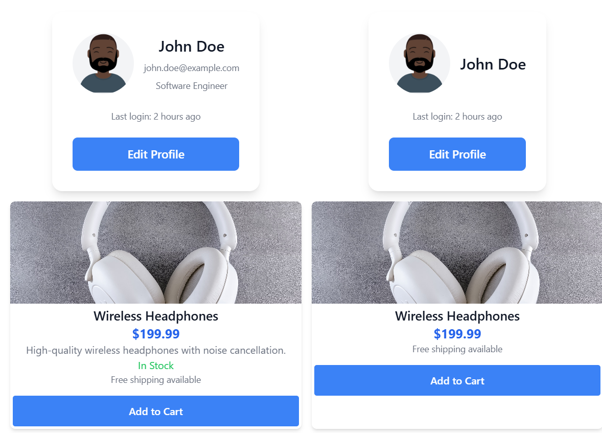
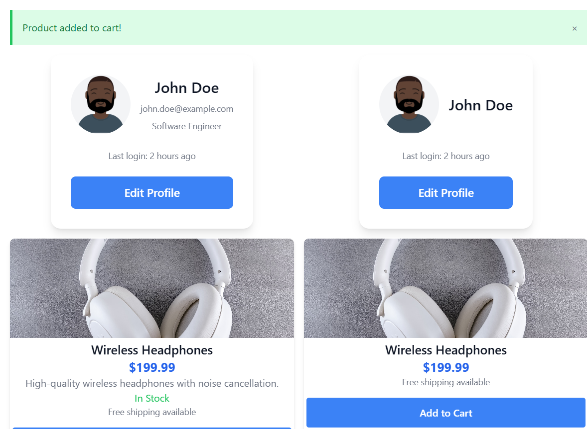

# Component library

A React page that renders the same person and the same product twice, with different props.

## Description

The left cards show more detail. The right cards hide the email, role, description, and stock line. There is no router, and the page does not list the cart.

The page does not set a background color. Profile cards are white. Product cards have no fill of their own, so the name, price, and description sit on the page background.

John Doe appears twice. Email `john.doe@example.com` and role Software Engineer show only on the first card. Both cards include “Last login: 2 hours ago” and an Edit Profile button. Edit Profile opens a browser alert that says `Editing user 1`.

Wireless Headphones, at `$199.99`, appear twice. The description and the green **In Stock** line show only on the first card. Both cards include “Free shipping available” and an Add to Cart button. The button stays enabled because this product is in stock. Add to Cart shows a green alert, “Product added to cart!”, with a close button. The close button hides the alert.

`AlertBox` can also render error, warning, and info styles, and `ProductDisplay` can disable the button and label it Out of Stock when `inStock` is false. This page only uses the success alert and an in-stock product.

The avatar and the headphone photo load from other sites, so those images need a network connection.

## Screenshots

### The page



### Added to cart



## Getting Started

### Dependencies

* Node.js and npm
* A network connection for the avatar and the headphone photo

### Installing

```bash
npm install
```

### Executing program

```bash
npm run dev
```

Vite serves the app at `http://localhost:5173/`.

## Help

The page does not list the cart. Add to Cart only shows the green alert “Product added to cart!”. The close button hides that alert. Edit Profile opens a browser alert that says `Editing user 1`.

## Authors

[Mamadou Moussa Balde](https://www.linkedin.com/in/2mb/)

## Version History

* Current local run
    * Vite at `http://localhost:5173/`
    * Two profile cards and two headphone cards, then the success alert

## License

This folder does not include a `LICENSE.md` file.

## Acknowledgments

* [README template](https://gist.github.com/DomPizzie/7a5ff55ffa9081f2de27c315f5018afc)
